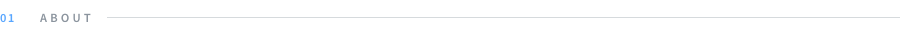
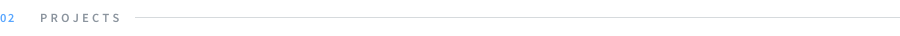
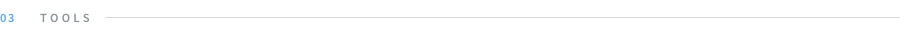
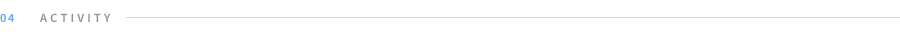

I'm a mechanical engineering student at the Sabaragamuwa University of Sri Lanka, and I build practical software on the side. I care about tools that are simple to use and take repetitive work off people's hands.

