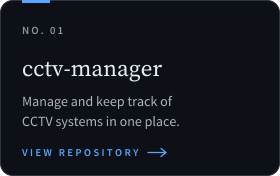

Hi, I'm **Sankha**, a mechanical engineering student from Neluwa, Sri Lanka, studying at Sabaragamuwa University.
I like building small, useful software that makes boring, repetitive jobs disappear.

